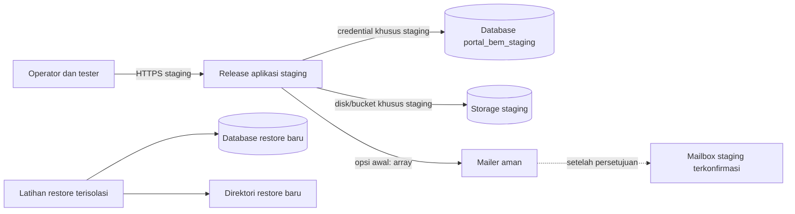

# Tahap 8 — Rencana Staging Aman

Tanggal audit lokal: 31 Oktober 2026 (Asia/Bangkok)  
Proyek: Portal BEM Terpadu  
Tujuan: menyediakan lingkungan non-production untuk pemeriksaan browser, keamanan, notifikasi staging, dan latihan pemulihan.

## 1. Status dan batas rencana

Rencana ini adalah instruksi operator, bukan bukti staging sudah tersedia. Pada audit lokal, tidak ada URL/akses staging, akun operator, browser, mailbox staging, host restore, atau arsip backup terverifikasi yang tersedia. Tidak ada server yang dibuat, environment lokal yang diubah, atau koneksi tulis ke database aktif yang dilakukan.

Pemeriksaan aman lokal lulus: suite test terisolasi, route, build frontend, dan status migrasi read-only. Lingkungan lokal bukan staging; konfigurasi lokal menunjukkan `APP_ENV=local`, debug aktif, database default MySQL, dan mailer log. PHPUnit secara terpisah memakai SQLite `:memory:` dan mailer `array`.

## 2. Arsitektur yang diusulkan



Komponen staging harus terpisah dari database `portal_bem`, storage lokal, production, dan kredensial production. Jalur jaringan maupun credential staging tidak boleh menunjuk resource production. Latihan restore memakai DB dan direktori baru yang berbeda dari staging aktif dan production.

## 3. Prasyarat operator

Sebelum pengujian tulis, pemilik layanan/DevOps/DBA harus menyediakan dan mengonfirmasi:

1. URL staging melalui HTTPS dan identitas host yang jelas.
2. Release aplikasi staging pada host/namespace non-production; document root hanya ke `public/`.
3. Database khusus (mis. `portal_bem_staging`), server/credential staging, dan bukti bahwa target bukan database `portal_bem` atau production.
4. Disk/bucket dan path staging tersendiri, symlink `public/storage` hanya ke storage staging, serta permission minimum untuk web process.
5. Environment staging dengan `APP_ENV=production`, `APP_DEBUG=false`, `APP_URL=https://...staging...`, `APP_KEY` unik staging, session cookie secure, dan tidak menyalin `.env`/database production.
6. Mailer aman: `MAIL_MAILER=array` untuk pemeriksaan dasar; mailbox staging dan credential khusus hanya untuk pemeriksaan SMTP yang telah disetujui eksplisit.
7. Browser versi yang didukung operator; DevTools tersedia untuk pemeriksaan cookie/session tanpa menyalin nilainya.
8. Akun sintetis untuk `super_admin`, `admin`, `advokasi`, `editor`, serta akun nonaktif. Siapkan dua super admin sintetis aktif agar uji RBAC tidak mengunci akses staging.
9. Dataset sintetis: berita bergambar/tanpa gambar dan referensi gambar hilang; konten public/draft; data aspirasi anonim/nonanonim; payload CSV formula sintetis. Jangan salin data production.
10. Backup sebelum perubahan skema, prosedur rollback release, pemilik keputusan, jendela uji, dan kanal insiden yang disetujui.

Jangan menaruh password, APP_KEY, token, tracking code, mailbox pribadi, isi aspirasi, atau detail koneksi di dokumen/checklist umum. Konfirmasi hanya nilai boolean/alias yang sudah disamarkan.

## 4. Konfigurasi staging yang diharapkan

Atur melalui secret manager atau mekanisme server milik operator, bukan dengan mengubah `.env` lokal. Nilai minimum:

```dotenv
APP_ENV=production
APP_DEBUG=false
APP_URL=https://<host-staging-yang-disetujui>
APP_TIMEZONE=Asia/Jakarta

DB_CONNECTION=mysql
DB_HOST=<host-database-staging>
DB_PORT=3306
DB_DATABASE=portal_bem_staging
DB_USERNAME=<user-staging-hak-minimum>
DB_PASSWORD=<secret-dikelola-di-kanal-aman>

FILESYSTEM_DISK=public
SESSION_SECURE_COOKIE=true
MAIL_MAILER=array
```

Placeholder bukan nilai siap pakai. Jika menguji SMTP nyata, ganti `array` hanya setelah persetujuan dan mailbox staging penerima/pelapor dikonfirmasi. Gunakan credential SMTP khusus staging, bukan credential production. Pastikan host, URL, database, storage, serta mailer yang benar terbaca sesudah cache dibangun tanpa mencetak rahasia.

## 5. Urutan persiapan staging

1. **Gate akses:** operator dan pemilik layanan menyetujui scope, URL, akun uji, data sintetis, jendela pemeriksaan, dan prosedur penghentian. Tanpa konfirmasi isolasi, semua tes tulis tetap BLOCKED.
2. **Provision resource:** DBA membuat database/schema staging terpisah dengan user hak minimum. Operator menyediakan storage khusus staging, host dan TLS HTTPS, backup, serta direktori release baru. Jangan mengubah database lokal atau production.
3. **Siapkan release:** pasang dependency dari lockfile dan build aset pada CI/release host. Jalankan pemeriksaan versi/ekstensi dan `composer check-platform-reqs`. Jangan memodifikasi `vendor/`.
4. **Pasang environment:** konfigurasi staging via secret manager. Jangan menyalin `.env` atau database production. Pastikan `APP_ENV=production`, `APP_DEBUG=false`, URL HTTPS, database khusus, storage khusus, dan mailer `array`.
5. **Cache & schema:** setelah target DB diverifikasi dua orang/dua sumber, ambil backup database staging sebelum perubahan skema. Tinjau migration yang tertunda dan jalankan hanya pada staging setelah persetujuan operator. Jangan menggunakan `migrate:fresh`, `db:wipe`, `DROP DATABASE`, atau migration ke `portal_bem`.
6. **Storage & accounts:** buat symlink staging menuju disk staging; periksa read/write minimum. Buat akun sintetis dan dataset uji sesuai prosedur organisasi. Simpan password hanya pada password manager staging.
7. **Validasi awal:** operator memeriksa environment tanpa membagikan output mentah, lalu membuka beranda, login, sitemap, robots, dan halaman 404 melalui browser staging. Jika ada konfigurasi salah, hentikan tes tulis dan minta operator memperbaiki staging.
8. **Jalankan checklist:** mulai dari HTTP read-only, lanjut ke role/form/CSV hanya dengan data sintetis, lalu SMTP dan restore paling akhir setelah masing-masing gate disetujui.
9. **Bersihkan data uji:** hapus hanya record sintetis yang dibuat untuk sesi itu, berdasarkan ID catatan staging terbatas dan prosedur cleanup yang disetujui. Jangan menjalankan penghapusan massal.
10. **Tutup sesi:** operator menyimpan bukti tersamarkan, mengembalikan konfigurasi mailer aman, mencabut credential sementara, memastikan storage/log dipertahankan, dan melaporkan defect/insiden.

## 6. Urutan pemeriksaan yang aman

1. Periksa environment, HTTPS, route publik, asset, metadata, sitemap, robots, 404, dan navigasi tanpa submit form.
2. Uji viewport dan keyboard/focus pada halaman publik.
3. Uji login/logout serta request GET langsung per role dengan akun sintetis. Verifikasi session rotation tanpa mencatat cookie/session ID.
4. Uji draft/fiktif, form validation, aspirasi sintetis anonim/nonanonim, tracking salah/benar, status/respons, dan batas rate pada instance yang tidak digunakan pengguna lain.
5. Uji form CSRF dengan request sintetis tanpa token/invalid token; verifikasi tidak ada perubahan record. Fault injection 500 hanya melalui metode staging yang disetujui operator.
6. Uji filter, CSV, audit log, serta privasi memakai payload sintetis. Jangan mengunggah CSV mentah atau menyimpan kode pelacakan di laporan.
7. Uji mailer `array` terlebih dahulu. SMTP nyata adalah langkah opsional terakhir yang memerlukan persetujuan eksplisit dan mailbox staging yang telah dikonfirmasi.
8. Latihan backup/restore dilakukan terpisah dari tes fungsional ke DB kosong baru dan direktori kosong baru setelah arsip/checksum diverifikasi.

## 7. Isolasi database dan storage

- Sebelum migration atau test tulis, operator/DBA memeriksa nama host dan database dari konfigurasi staging tanpa membagikan credential. Verifikasi dengan inventory server, bukan hanya nama `.env`.
- Kredensial staging sebaiknya tidak memiliki route network atau permission ke database production. Akun staging hanya diberi hak yang diperlukan aplikasi staging.
- PHPUnit lokal tetap menggunakan `DB_CONNECTION=sqlite`, `DB_DATABASE=:memory:` dan mailer `array`; jangan mengubah konfigurasi ini agar menyambung ke MariaDB.
- Storage staging menggunakan volume/bucket/path unik. Pastikan symlink `public/storage` mengarah ke path staging itu sendiri. Jangan mount folder upload lokal/production ke staging.
- Backup database dan file staging juga diperlakukan sensitif. Jangan mengembalikan arsip production ke staging tanpa proses sanitasi/otorisasi terpisah.

## 8. Backup, restore, dan rollback

Sebelum perubahan schema, backup database serta storage staging, catat waktu/checksum di sistem terbatas, dan verifikasi backup dapat dibaca. Latihan restore hanya dilakukan setelah DBA membuktikan arsip asalnya dan checksum cocok, lalu membuat DB tujuan baru (contoh `portal_bem_restore`) dan direktori restore baru. Pastikan target bukan `portal_bem` maupun production. Jangan memakai drop untuk membuat target kosong; pilih nama target baru.

Restore DB dan storage secara terpisah. Cocokkan checksum, tabel/data inti, referensi file/gambar, dan lakukan smoke test pada aplikasi recovery. Latihan restore Tahap 8 belum dilakukan. Jika migration atau smoke test gagal, hentikan promosi, pertahankan log, alihkan kode ke release sebelumnya hanya bila skema kompatibel, dan libatkan DBA. Jangan rollback migration otomatis.

## 9. Bukti yang dicatat

Untuk setiap ID checklist catat waktu/zona, operator, URL staging yang disamarkan, browser/versi, viewport jika relevan, langkah, status, respons yang tidak sensitif, dan tindak lanjut. Jangan simpan password, APP_KEY, token CSRF, cookie/session ID, tracking code, identitas pelapor, isi aspirasi, kredensial mail, atau CSV berisi data privat. Status PASS hanya diberikan sesudah langkah benar-benar dilakukan dan hasil yang diharapkan terlihat.

## 10. Gate penghentian

Hentikan skenario terdampak dan beri tahu pemilik/security operator bila database/storage target tidak jelas, redirect keluar staging, draft/aspirasi privat terbuka, identitas anonim bocor, request CSRF mengubah data, error menampilkan secret, akun tak berizin memperoleh akses, atau rate test memengaruhi pengguna lain. Pertahankan bukti yang sudah disamarkan; jangan menghapus log atau record yang bukan data sintetis sesi.

Pembaruan status dan bukti operator dicatat di [Checklist Tahap 8](TAHAP-8-CHECKLIST-STAGING.md) dan [Laporan Tahap 8](TAHAP-8-LAPORAN.md).
