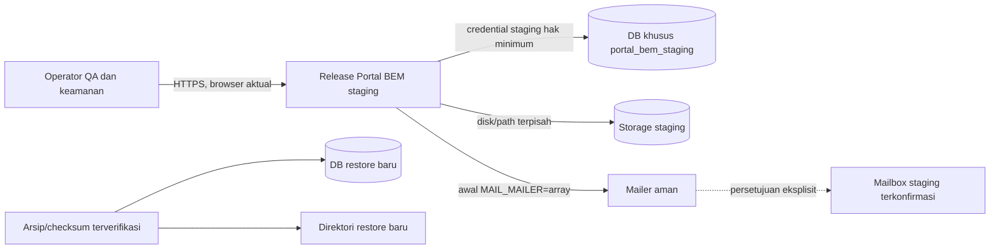

# Tahap 9 — Rencana Implementasi dan Uji Staging

Tanggal pemeriksaan lokal: 31 Oktober 2026 (Asia/Bangkok)  
Proyek: Portal BEM Terpadu  
Status pelaksanaan: **staging belum tersedia/terbukti pada sesi ini**. Dokumen ini adalah runbook untuk operator, bukan klaim bahwa deployment telah dilakukan.

## Ringkasan gate

Audit lokal aman lulus: 107 test/461 assertions, 60 route, status 11 migration terbaca tanpa menjalankan migration, dan build Vite berhasil. `phpunit.xml` mengisolasi test ke SQLite `:memory:` dan mailer `array`. Environment aplikasi lokal adalah `local`, debug aktif, database default MySQL, mailer `log`; local tidak cocok untuk uji tulis/browser staging.

Belum ada URL/host staging, bukti database/storage terpisah, akun sintetis, browser, mailbox staging, arsip backup/checksum, atau target restore. Karena gate ini belum terpenuhi, tidak ada deployment, migration, test tulis pada UI, email SMTP, atau restore yang dilakukan.

## 1. Arsitektur staging yang disyaratkan



Staging dan restore harus berada pada namespace/host non-production serta menggunakan resource dan credential khusus. DB/storage staging tidak boleh berbagi target dengan `portal_bem`, production, atau storage lokal. Restore dilakukan pada DB dan direktori baru yang terpisah dari staging aktif.

## 2. Prasyarat yang harus dikonfirmasi operator

Jangan lanjut ke deployment atau langkah yang menulis data sebelum semua butir kritis berikut memiliki bukti dari pemilik layanan/DevOps/DBA:

1. URL HTTPS staging dan host/namespace non-production yang teridentifikasi.
2. Akses yang sah ke release host, database, storage, dan log staging.
3. Database khusus staging (contoh `portal_bem_staging`) serta user dengan hak minimum. DBA mengonfirmasi host/schema bukan `portal_bem` dan bukan production melalui inventory terpisah, bukan nama config saja.
4. Storage/volume/bucket dan path unik; document root hanya `public/`; symlink `public/storage` menunjuk storage staging; permission minimum sudah diuji.
5. Environment staging: `APP_ENV=production`, `APP_DEBUG=false`, `APP_URL=https://...staging...`, APP_KEY unik staging, cookie sesi secure, dan secret dikelola kanal aman.
6. Mailer awal `array`. SMTP nyata terpisah dan tetap disabled sampai persetujuan eksplisit, mailbox admin/pelapor staging, dan credential khusus staging dikonfirmasi.
7. Browser aktual versi yang dicatat serta DevTools. Browser tidak tersedia pada audit lokal ini.
8. Akun sintetis `super_admin`, `admin`, `advokasi`, `editor`, akun nonaktif, dan dua super admin sintetis aktif. Simpan kredensial hanya pada password manager staging.
9. Dataset sintetis: berita bergambar/tanpa gambar/file hilang, agenda, program, public/draft, aspirasi anonim/nonanonim, serta payload CSV. Dilarang menyalin database atau data pribadi production.
10. Backup sebelum perubahan schema, rencana rollback release, pemilik persetujuan migration, batas rate test, prosedur hentikan tes, dan kontak insiden.

Operator cukup memberi konfirmasi tersamarkan (mis. `staging_url_https=true`, `db_isolated=true`); jangan menempel secret, APP_KEY, password, ticket/tracking code, session/cookie, isi aspirasi, atau koneksi database ke dokumen umum.

## 3. Persiapan release staging

Setelah gate prasyarat dibuktikan:

1. Buat release directory baru pada host staging; jangan deploy ke production atau local XAMPP.
2. Pasang dependency dari lockfile dan verifikasi platform; jangan mengubah `vendor/`:

   ```bash
   composer install --no-dev --prefer-dist --optimize-autoloader
   composer check-platform-reqs
   npm ci
   npm run build
   ```

   Di audit lokal, PHP CLI 8.5.12, Laravel 13.39.0, PHPUnit 12.5.42, Node 26.13.0, npm 11.20.0, dan Vite 8.3.5 teramati. GD/Imagick tidak terpasang di PHP CLI lokal; operator harus memeriksa PHP-FPM staging sesuai kebutuhan gambar dan persyaratan README.

3. Pasang environment staging melalui secret manager. Jangan menyalin `.env` production/lokal. Konfirmasikan environment, debug, URL, DB, storage, session, dan mailer tanpa menampilkan nilainya.
4. Pastikan TLS valid, HTTP diarahkan ke HTTPS, document root menunjuk ke `public/`, dan folder framework/cache dapat ditulis user web tanpa permission terbuka.
5. Sebelum schema berubah, ambil backup DB dan storage staging; cocokkan checksum dan catat pada sistem terbatas.
6. Tinjau hasil `php artisan migrate:status` serta setiap migration tertunda. Operator/DBA memverifikasi target dari inventory; baru jalankan `php artisan migrate --force` pada staging setelah persetujuan. Jangan jalankan `migrate:fresh`, `db:wipe`, `DROP DATABASE`, atau migration pada DB lokal/production.
7. Bangun cache yang diperlukan hanya pada release staging yang sudah benar:

   ```bash
   php artisan optimize:clear
   php artisan config:cache
   php artisan route:cache
   php artisan view:cache
   ```

8. Aktifkan release menggunakan mekanisme operator. Verifikasi halaman read-only awal, storage, dan error generik sebelum memasukkan dataset sintetis.

## 4. Urutan uji browser dan keamanan

1. **Read-only publik:** `/`, `/berita` dan detail, `/program-kerja` dan detail, `/agenda` dan detail, `/organisasi`, `/tentang`, `/kontak`, `/faq`, `/aspirasi`, `/aspirasi/kirim`, `/aspirasi/lacak`, `/sitemap.xml`, `/robots.txt`; periksa status, navigasi, pencarian/filter/pagination, gambar/placeholder, title/description/canonical/OG/Twitter, draft dan slug fiktif. Robots bukan kontrol akses.
2. **Visual/a11y:** viewport 320×720, 375×812, 768×1024, 1024×768, dan 1440×900; menu, tabel, overflow, keyboard Tab/Shift+Tab/Enter/Space/Escape, label, alt, focus indicator, dan keterbacaan.
3. **Auth/RBAC:** login/logout, akun nonaktif, perubahan sesi tanpa menyimpan nilai cookie, tombol Back, serta request langsung per role. Ikuti matriks kebijakan yang benar-benar diterapkan dan pastikan super admin aktif terakhir terlindungi.
4. **Aspirasi:** data sintetis anonim/nonanonim, field wajib, kategori salah, tracking benar/salah, tiket saja, rate limit pada instance yang tidak dipakai pengguna lain, histori/status/respons, dan ketiadaan PII anonim pada laporan.
5. **CSRF/errors:** request tanpa/CSRF invalid harus ditolak tanpa efek samping; periksa 403/404/500 dengan debug mati. Fault injection 500 hanya dengan metode yang disetujui di staging.
6. **CSV/audit:** filter tanggal/kategori/status, batas rentang, role export/audit, karakter formula `=`, `+`, `-`, `@`, tab, CR, LF; pastikan tidak ada PII, IP, tracking/hash, atau catatan internal. Jangan lampirkan CSV mentah.
7. **Email:** periksa dulu mailable dengan mailer `array`. SMTP nyata adalah uji terpisah, hanya setelah izin/mailbox/credential staging disetujui dan dikonfirmasi.
8. **Restore:** latihan terpisah memakai arsip asal diketahui, checksum cocok, DB baru, dan direktori baru. Validasi data, tabel, gambar, lalu smoke test aplikasi recovery.

Untuk setiap langkah catat waktu/zona, browser/viewport, status, bukti yang disamarkan, dan tindak lanjut. Jangan menyalin secret, data pelapor, session/token, tracking code, atau isi aspirasi. Jika menemukan kebocoran/akses tanpa izin/CSRF menulis data, hentikan skenario terkait dan eskalasi; pertahankan bukti/log.

## 5. Email, backup, dan penghentian

SMTP nyata hanya bila pemilik proyek menyetujui secara eksplisit penerima dan waktu uji, mailbox staging dikonfirmasi, credential SMTP staging disalurkan aman, dan host memakai database/storage staging terisolasi. Verifikasi email admin tidak mengandung kode pelacakan/identitas anonim dan email pelapor hanya kepada inbox sintetis yang disetujui. Jangan mengirim ke pengguna nyata.

Restore hanya bila backup dapat diidentifikasi, checksum diverifikasi independen, DBA membuat DB target baru yang terpisah (contoh `portal_bem_restore`) dan direktori baru, serta operator memastikan kedua target bukan lokal/staging aktif/production. Jangan menghapus database untuk memperoleh target kosong. Pulihkan DB dan file terpisah, cek jumlah data/tabel/gambar, lalu smoke test pada environment recovery. Tidak ada restore yang dijalankan dalam audit ini.

Rollback utama adalah alih release kode sebelumnya hanya bila kompatibel dengan schema. Jangan rollback migration otomatis. Jika target atau bukti isolasi tidak jelas, jangan deploy/migrate/test tulis; statusnya BLOCKED dan minta operator/DBA melengkapi prasyarat.

## 6. Pencatatan status

Status pemeriksaan sesi ini ada di [Checklist Tahap 9](TAHAP-9-CHECKLIST-STAGING.md). Ringkasan bukti, command dan keputusan ada di [Laporan Tahap 9](TAHAP-9-LAPORAN.md). Dokumen Tahap 8 dipertahankan sebagai histori; hasil Tahap 9 tidak menulis ulang status Tahap 8.
